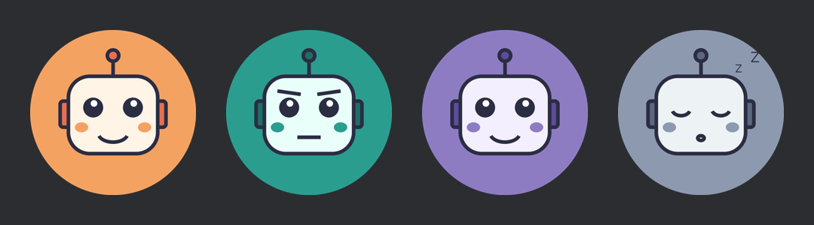

# T3 Code Discord Rich Presence

Show what you are doing in [T3 Code](https://github.com/pingdotgg/t3code) as your Discord status, like the Discord presence extensions for VS Code.

> **Playing T3 Code**
> Working on my-project
> 2 agents running · Opus 5.5
> 00:42 elapsed

A cartoon agent badge sits in the corner of the status. It changes with the agent that is working, and falls asleep when nothing is running:



> Unofficial. Not made by or affiliated with Ping or the T3 Code team.

## Features

- Shows your current T3 Code project, how many agents are running, and the model
- Agent avatar badge: Claude, Codex, other agents, and a sleepy one when idle
- Elapsed timer while T3 Code is open; status clears when you close it
- Reconnects on its own when Discord restarts
- Starts automatically at login
- Thread titles are hidden by default, since they can contain private work details
- One Python file, standard library only, nothing to install
- Reads T3 Code's local database in read-only mode; never writes to it

## Requirements

- macOS
- [T3 Code](https://github.com/pingdotgg/t3code) desktop app
- Discord desktop app (open and logged in)
- Python 3.8 or newer (`python3 --version`)

## Install

```bash
git clone https://github.com/arkajyotiadhikary/t3code-discord-presence.git ~/t3code-discord-presence
cd ~/t3code-discord-presence
./install.sh
```

That's it. Your status appears within about 15 seconds.

If nothing shows up, check **Discord → Settings → Activity Privacy → Share your detected activities with others**.

To stop it for good: `./uninstall.sh`

### Restart button inside T3 Code

T3 Code project actions can run a command. Add one to any project:

- **Name:** Restart Discord Presence
- **Command:** `~/t3code-discord-presence/install.sh`

## Settings

Edit `config.json`, then run `./install.sh` again to restart.

| Key | Default | What it does |
| --- | --- | --- |
| `show_project` | `true` | Show the project name |
| `show_thread_title` | `false` | Show the current thread title |
| `show_model` | `true` | Show the model name |
| `show_agent_count` | `true` | Show how many agents are running |
| `show_agent_avatar` | `true` | Show the cartoon agent badge |
| `poll_seconds` | `15` | How often to check T3 Code |
| `idle_text` | `Idle` | Text when no agent is running |
| `client_id` | shared app | Discord application ID (see below) |
| `large_image` | `t3code` | Art asset name, or an `https://` image URL |
| `image_base_url` | `""` | Load pictures from `<url>/<name>.png` instead of Discord assets |

### Using your own Discord application (optional)

The default `client_id` points to a shared Discord app that already has the pictures. To use your own name or art:

1. Create an app at https://discord.com/developers/applications. Its name is what shows after "Playing".
2. Upload pictures under **Rich Presence → Art Assets** named `t3code`, `agent_claude`, `agent_codex`, `agent_other`, `agent_idle`. The robots are in `art/`; `art/terminal.png` works as the `t3code` picture.
3. Put the Application ID in `config.json` as `client_id` and run `./install.sh`.

## How it works

Every 15 seconds the script:

1. Checks whether T3 Code is running.
2. Reads `~/.t3/userdata/statev2.sqlite` (read-only) to find the active project, running agents, and model.
3. Sends the status to the Discord app over its local socket (`$TMPDIR/discord-ipc-0`).

T3 Code is in beta and its database layout can change. If an update breaks the status, check `presence.log` and open an issue.

## Troubleshooting

- **No status at all:** run `tail presence.log`. Make sure Discord is open and activity sharing is on.
- **Blank pictures:** Discord can take a few minutes to load new art. Press Cmd+R in Discord.
- **Stopped after a restart:** run `./install.sh` again, or use the T3 Code button.

## Art

The robot avatars are drawn by `art/make_art.py` (needs Pillow: `pip install pillow`). Change the colors there and run it to make new ones.

## License

MIT
